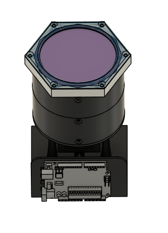
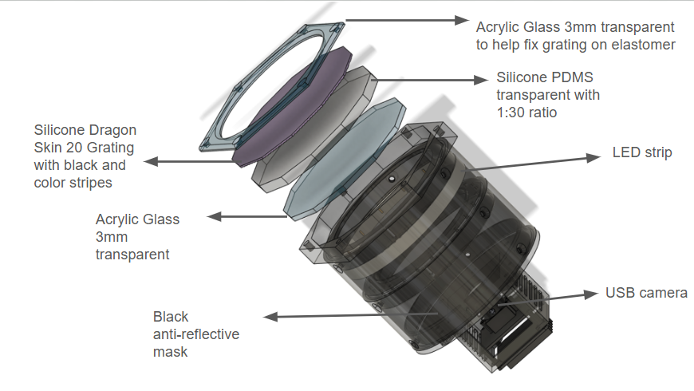
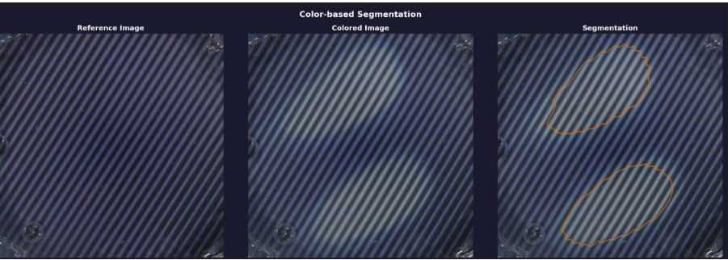

# Physical Decoupled Multimodal Vision-Bassed Programmable Skin

<p align="center">
  
  
</p>

A programmable elastomer skin — one printed stripe pattern, imaged with an
ordinary phone or USB camera — is enough to recover **what touched it, how
hard, how deep, and how hot**, with no embedded electronics and no
specialised imaging hardware. What makes this possible is that the two
signals encoded in the pattern are **physically decoupled**: mechanical
contact distorts the stripe *geometry* while barely touching stripe
*colour*, and a temperature change shifts stripe *colour* while barely
touching stripe *geometry*. Because the two effects are almost orthogonal,
a single photo pair carries independent **multimodal**, vision-only tactile
and thermal readouts. This repository is the full image-processing pipeline
behind that idea: it turns a before/after photo pair of the membrane into
contact shape, force, indentation depth, and surface temperature, and
includes the raw calibration photo sets and CSVs the pipeline was built and
validated against, so every result in the accompanying thesis is
reproducible end to end.

The core trick is that one printed pattern carries two independent signals.
A press distorts the stripe *geometry* (their spacing and shape) without
noticeably changing their *colour*; a temperature change shifts the stripe
*colour* without changing their spacing. Because the two effects are almost
orthogonal, they can be decoded independently from the same photo and then
recombined — cheaply, and with commodity cameras — into a single tactile +
thermal readout. Concretely, each image pair — one *reference* (undeformed /
unheated) and one *deformed* (pressed and/or heated) — is analysed with two
independent, image-only pipelines:

- **`src/tactile/`** — Fourier Transform Profilometry (FTP): a press distorts
  the printed stripe pattern, and that distortion is decoded into contact
  shape, force, and depth.
- **`src/temperature/`** — colour/LAB analysis: a temperature change shifts
  the stripe colour, which is decoded into a predicted temperature via k-NN
  regression against a calibration CSV, and detected as a segmented
  colour-change region.

`src/integrated_pipeline.py` runs both stages on one image pair and
reconciles them, so temperature-only artefacts don't get reported as
presses and vice versa.

## How it works

The sensor surface is printed with a regular stripe/fringe pattern. Two
independent physical effects perturb that pattern in distinguishable ways:

1. **Mechanical contact** locally compresses/stretches the stripes —
   measurable as a **phase shift** of the fringe pattern (FTP) — but leaves
   stripe *colour* essentially unchanged (chroma shift ~2.5 LAB units).
2. **Temperature change** shifts the stripe *colour* (LAB chroma shifts of
   ~8–12 units) but leaves the stripe *spacing/period* unchanged.

Each pipeline exploits one of these effects and (approximately) ignores the
other, so they can run on the same image pair and be combined without one
contaminating the other's result.



## Repository layout

```
src/
  integrated_pipeline.py          combined pipeline: colour stage + tactile stage
  tactile/
    detect_shape.py                shape detection from stripe phase distortion (FTP)
    estimate_force_depth.py        global stripe-period ratio -> force -> depth (single ROI)
    uniform_reconstruct.py         per-contact reconstruction: shape + force + depth + 3-D plot
  temperature/
    color_merged.py                stripe/flatfield segmentation + interactive temperature viewer
    color_prediction.py            ColorPredictor: k-NN temperature regression (purple stripes)
    black_prediction.py            BlackPredictor: k-NN temperature regression (black stripes)
    color_segment.py               standalone flatfield/z-score segmentation script (debug/dev)
    batch_temperature_validation.py batch predicted-vs-actual validation over labelled image folders
data/
  raw/
    shape_pictures/                 reference + deformed image sets for the tactile pipeline, by shape
    force_pictures/                 reference + known-force image sets for tactile force/depth calibration
    full_color_experiment/          purple-stripe temperature data (calibration + heating/cooling runs)
    black_and_color_experiment/     black-stripe temperature data (calibration + heating/cooling runs)
    final_images/                   one example reference/deformed pair used for the report figures below
  masks/                           ROI/segmentation mask images used by the tactile and temperature scripts
  processed/
    csv_files/                     calibration CSVs (force<->ratio, force<->depth, colour<->temperature)
results/
  images_report/                  output figures generated by the pipelines, used in the thesis write-up
```

## Pipeline 1 — Tactile: shape, force, and depth (`src/tactile/`)

Given a **reference** (unloaded) and **deformed** (loaded) image of the
striped membrane:

1. **`detect_shape.py`** — demodulates the stripe carrier via FFT, computes
   the phase difference between reference and deformed images (unwrapped),
   turns it into a robust z-score map, and thresholds/cleans it (hysteresis
   threshold, morphological close/open, hole-filling, component filtering)
   into a binary mask of the contact shape. Each connected component is a
   separate contact. Optional auxiliary channels (`--use-orient`,
   `--use-amp`) can help on weak contacts.
2. **`estimate_force_depth.py`** — given a single ROI mask, measures the mean
   stripe period (via 2-D FFT with sub-pixel refinement) in the reference and
   deformed images. The ratio `period_deformed / period_reference` is mapped
   to a force via a linear fit to a `force_vs_mean_width_ratio.csv`
   calibration table, and force is mapped to depth via PCHIP interpolation
   through a `force_vs_mean_depth.csv` table (linearly extrapolated beyond
   the table's range). This is the simplest, single-region version of the
   measurement.
3. **`uniform_reconstruct.py`** — the full per-contact version: for each
   shape detected by `detect_shape.py`, erodes away the rim (a kinematic
   artefact, not a pressure signal), takes **one global masked FFT** of the
   interior at full camera resolution to get its stripe period, and applies
   the same ratio → force → depth calibration chain per contact. Supports an
   area correction (the membrane responds to *pressure*, i.e. force/area, so
   the measured ratio is rescaled to what the calibration circle would show
   at the same force) and renders an interior/overlay figure plus a
   mouse-rotatable 3-D surface plot (flat plateau per contact, feathered at
   the rim).

**Calibration data**: the width-ratio/depth CSVs and calibration ROI mask
generated for this rig are included in
[`data/processed/csv_files/`](#dataprocessedcsv_files--calibration-tables)
and [`data/masks/`](#datamasks--roi-and-segmentation-masks) — see those
sections below. To recalibrate against your own rig, regenerate
`force_vs_mean_width_ratio.csv`, `force_vs_mean_depth.csv`, and an ROI mask
image (white circle on black) for the calibration circle's area from a
controlled loading experiment.

Run standalone, e.g.:
```bash
python src/tactile/uniform_reconstruct.py 
```

## Pipeline 2 — Temperature: colour-based prediction (`src/temperature/`)

1. **`color_merged.py`** — the main entry point. Detects stripes via
   row-adaptive peak finding on the value channel, separates "purple" and
   "black" stripe pixels into masks, and launches an **interactive
   matplotlib pop-up**: click any stripe pixel to see its predicted
   temperature (see `ColorPredictor` / `BlackPredictor` below). It also
   contains a gated colour-change segmentation (used by the integrated
   pipeline) that flags a "temperature change" region only when the local
   LAB chroma shift and area exceed configurable thresholds — set high
   enough that a mechanical press (which barely shifts chroma) doesn't
   falsely trigger it.
2. **`color_prediction.py`** (`ColorPredictor`) / **`black_prediction.py`**
   (`BlackPredictor`) — inverse-distance-weighted k-NN regression from pixel
   colour to temperature, calibrated from a CSV of (temperature, colour)
   samples. Each supports RGB, HSV, and/or LAB colour spaces (features are
   min-max normalised per channel); with `color_space="auto"`, whichever
   space gives the closest nearest-neighbour match is used per query pixel.
   Two separate predictors/CSVs exist because the purple and black stripes
   have different colour-temperature responses.
3. **`color_segment.py`** — a standalone, non-interactive dev/debug script
   for the flatfield + z-score segmentation step in isolation (produces
   diagnostic plots only; not needed for the main pipeline).
4. **`batch_temperature_validation.py`** — validation harness: point it at a
   folder of sub-folders named by their true temperature (e.g. `25/`, `26/`,
   ...), and for every image it predicts a temperature (via `ColorPredictor`
   or `BlackPredictor`, chosen with `PREDICTOR = "color" | "black"`), trims
   outliers, and plots predicted vs. actual temperature with error bars
   against a `y = x` reference line.

**Calibration data**: `data/processed/csv_files/average_temps.csv` (purple
stripes) and `data/processed/csv_files/average_temps_black.csv` (black
stripes) are included, each with a `Temperature` column plus R/G/B, H/S/V,
and L/a/b columns — see
[`data/processed/csv_files/`](#dataprocessedcsv_files--calibration-tables)
below. To recalibrate, regenerate these from your own temperature-controlled
reference shots.

## Combined pipeline (`src/integrated_pipeline.py`)

Runs both stages on one reference + one deformed image:

1. **Colour stage** — pops up the interactive temperature viewer on the
   deformed image, then checks reference vs. deformed for a genuine
   temperature change (gated on LAB chroma shift and area, since a press
   alone shouldn't trigger it) and saves a 3-panel segmentation figure only
   if one is found.
2. **Tactile stage** — reconstructs shape/force/depth per contact. Contacts
   with force at or below `MIN_FORCE_N` (default 0.5 N) are discarded as
   temperature-only artefacts, since a temperature change alone leaves the
   stripe period — and hence the computed ratio/force — essentially
   unchanged.

```bash
python src/integrated_pipeline.py 
```

Useful flags: `--area` (contact area in mm², for the force area-correction),
`--seg-chroma` / `--seg-min-area` / `--seg-min-blob` (temperature-change
segmentation gates), `--min-force` (tactile force-artefact gate),
`--z-exaggeration` (3-D plot z-scaling), `--no-show` (save files only, skip
all pop-up windows).

## Image folders

The repository includes the raw photo sets the pipelines above were built and
validated against. None of these are synthetic — they're phone photos of the
physical striped membrane, organised by experiment.

### `data/raw/shape_pictures/` — tactile shape reconstruction

One subfolder per contact shape (`F shape`, `P shape`, `Ring`, `Square`,
`Square Circle`, `Star`, `Three Circles`). Each contains 2-3
`WIN_*_Pro.jpg` photos of the membrane under that contact, and most also
include a `*_gt.jpg` ground-truth image (a photo/drawing of the pressed
object itself, for visually checking the reconstructed shape against it).
There's no separate "reference" (undeformed) image per shape folder — pick
any two same-shape images as reference/deformed, or use one of the
unloaded shots from `data/raw/force_pictures/reference/` as the shared
reference.

```bash
# detect_shape.py has no --reference/--deformed flags; edit REF_IMAGE /
# DEF_IMAGE in its CONFIG block, e.g.
#   REF_IMAGE = "data/raw/force_pictures/reference/WIN_20260526_16_22_36_Pro.jpg"
#   DEF_IMAGE = "data/raw/shape_pictures/Star/WIN_20260605_13_41_05_Pro.jpg"
# then run:
python src/tactile/detect_shape.py

# uniform_reconstruct.py and integrated_pipeline.py do take CLI overrides:
python src/integrated_pipeline.py \
  --reference "data/raw/force_pictures/reference/WIN_20260526_16_22_36_Pro.jpg" \
  --deformed "data/raw/shape_pictures/Ring/WIN_20260610_16_26_11_Pro.jpg" \
  -o output/ring
```

### `data/raw/force_pictures/` — tactile force/depth calibration

`reference/` holds unloaded membrane photos; the other subfolders (`3N`,
`6N`, `9N`, ... `48N`) each hold 5 photos taken under that known applied
force. This is the raw data used to build the
`force_vs_mean_width_ratio.csv` calibration table that
`estimate_force_depth.py` / `uniform_reconstruct.py` expect (measure the
stripe-period ratio for each `reference` vs `<N>N` pair and fit force vs.
ratio), and is also useful as a standalone accuracy check by running the
tactile pipeline on a pair and comparing the reported force to the folder's
label.

```bash
python src/tactile/estimate_force_depth.py \
  --reference "data/raw/force_pictures/reference/WIN_20260526_16_22_36_Pro.jpg" \
  --deformed "data/raw/force_pictures/24N/WIN_20260525_19_57_24_Pro.jpg" \
  --ratio-csv data/processed/csv_files/force_vs_mean_width_ratio.csv \
  --depth-csv data/processed/csv_files/force_vs_mean_depth.csv \
  --mask calibration_mask.png
```

### `data/raw/full_color_experiment/` and `data/raw/black_and_color_experiment/` — temperature calibration

Same layout, one per stripe colour (purple stripes vs. black stripes, used
by `ColorPredictor` and `BlackPredictor` respectively):

- **`Calibration images/`** (purple set only) — reference shots used to
  build the colour→temperature calibration CSV (`average_temps.csv`).
- **`Room Temperature/`, `Room Temperature 2/`** — baseline unheated shots;
  some include a `real_temp_room.txt` ground-truth reading.
- **`Heating Run/`, `Heating Run 2/`, `Heating Run 3/`** and
  **`Cooling Run/`, `Cooling Run 2/`** — one subfolder per target
  temperature (e.g. `24/`, `25/`, ... up to `75/`), each with ~10 photos
  and a `real_temp_<N>.txt` file giving the actual measured temperature for
  that batch. This is exactly the layout `batch_temperature_validation.py`
  expects for `DATA_ROOT`.
- `data/raw/black_and_color_experiment/` additionally has `Old cooling/` and
  `Old Heating/` (earlier, smaller calibration runs) — kept for reference,
  not used by the current calibration CSVs.

```bash
# Predicted-vs-actual validation over a whole run (edit DATA_ROOT / PREDICTOR
# in the CONFIG block at the top of the script, or pass the folder directly
# if you've parameterised it):
#   DATA_ROOT = "data/raw/full_color_experiment/Cooling Run"   PREDICTOR = "color"
#   DATA_ROOT = "data/raw/black_and_color_experiment/Heating Run"  PREDICTOR = "black"
python src/temperature/batch_temperature_validation.py

# Single-image interactive viewer: edit REF_IMAGE_PATH / IMG_IMAGE_PATH in the
# CONFIG block at the top of color_merged.py, e.g.
#   IMG_IMAGE_PATH = "data/raw/full_color_experiment/Heating Run/40/WIN_20260429_20_36_08_Pro.jpg"
# then run:
python src/temperature/color_merged.py
```

## Supporting data and output folders

### `data/processed/csv_files/` — calibration tables

The tables consumed by both pipelines at run time, plus the raw load-cell
logs and derived colour-calibration variants they were built from:

- `force_vs_mean_depth.csv` — force → indentation depth (used by
  `estimate_force_depth.py` / `uniform_reconstruct.py`).
- `force_vs_mean_width_ratio_frequency.csv` — stripe-period ratio → force fit
  data. (`estimate_force_depth.py`'s default `RATIO_CSV` points at
  `force_vs_mean_width_ratio.csv`; pass `--ratio-csv
  data/processed/csv_files/force_vs_mean_width_ratio_frequency.csv`
  explicitly, or rename the file, until the default is updated to match.)
- `liamtestforce-Run-*.csv` — raw load-cell run logs used to derive the
  force/ratio and force/depth calibration curves above.
- `average_temps.csv` / `average_temps_black.csv` — the colour→temperature
  calibration tables used by `ColorPredictor` / `BlackPredictor`
  respectively (each with a `Temperature` column plus R/G/B, H/S/V, and
  L/a/b columns).
- `average_temps_color_*` / `average_temps_black_*` / `average_temps_l_*` —
  per-run and per-colour-space variants (heating/cooling, "l" = LAB-only)
  used during calibration development and validation; not required by the
  main scripts but kept for reproducing the calibration analysis.

### `data/masks/` — ROI and segmentation masks

- `roi_mask_width_stripe.png` — the calibration-circle ROI mask used by
  `uniform_reconstruct.py` (`CALIB_MASK_PATH`) for the tactile area
  correction.
- `black_color_mask.jpg` — the stripe-colour mask used by
  `batch_temperature_validation.py` (`MASK_PATH`) to isolate stripe pixels
  before prediction.
- `color_mask.png` — companion purple-stripe mask generated by the same
  segmentation step.

### `data/raw/final_images/` and `results/images_report/` — example run and report figures

- `data/raw/final_images/` — one example `reference`/`deformed` image pair
  (`ref_image.jpg`, `def_image.jpg`) used to generate the walkthrough
  figures below; a convenient pair to try the pipeline on without digging
  through the experiment folders.
- `results/images_report/` — figures produced by the pipelines
  (shape/force/depth reconstructions, 3-D plots, colour-prediction and
  segmentation plots) and used directly in the thesis write-up: `figures/`
  (per-pipeline result figures), `figures_final/` (the final selected
  figures, generated from the `data/raw/final_images/` pair), and
  `3d_recon/` (rendered 3-D reconstructions per contact shape). These are
  outputs, not inputs — regenerate them by running the scripts above with
  `-o` pointed at this folder.

## Requirements

Python 3 with: `numpy`, `opencv-python`, `scipy`, `scikit-image`,
`matplotlib`, `pandas`.

## Notes on image paths and calibration files

All default paths in the `CONFIG` block at the top of each script are
**relative to the repository root**, so run every command from the top of
this repository (as in the examples above) and the bundled calibration CSVs
([`data/processed/csv_files/`](#dataprocessedcsv_files--calibration-tables)),
masks ([`data/masks/`](#datamasks--roi-and-segmentation-masks)), and sample
images resolve automatically — no path edits needed to reproduce the
included results.

A few `REF_IMAGE` / `DEF_IMAGE` (or `REF_IMAGE_PATH` / `IMG_IMAGE_PATH`)
defaults in `tactile/uniform_reconstruct.py`, `temperature/color_merged.py`,
and `temperature/color_segment.py` are left **blank** — they originally
pointed at development photos outside this repository (e.g. a phone's
camera roll) that aren't bundled here. Point these at any reference/deformed
pair under [`data/raw/`](#image-folders) before running those scripts
standalone, or use the corresponding CLI flags (`--reference`, `--deformed`)
where available.
