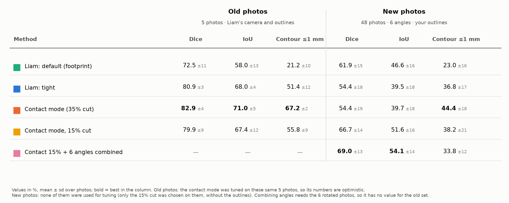
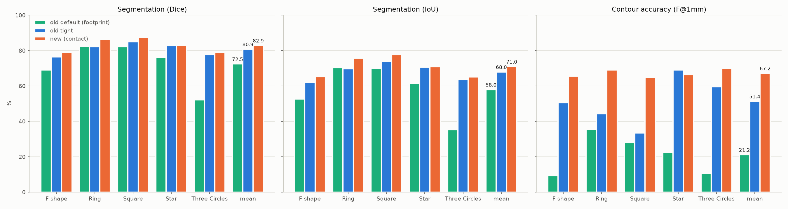
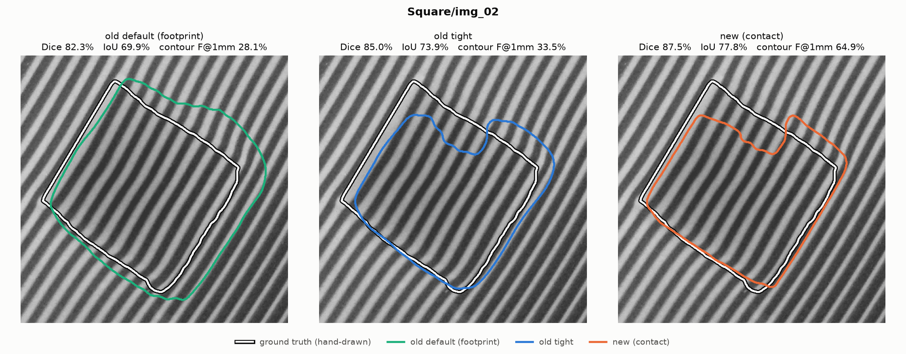
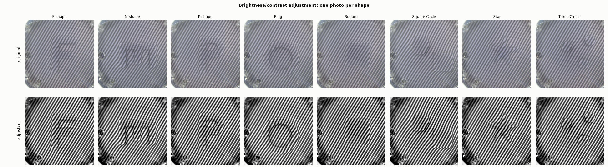
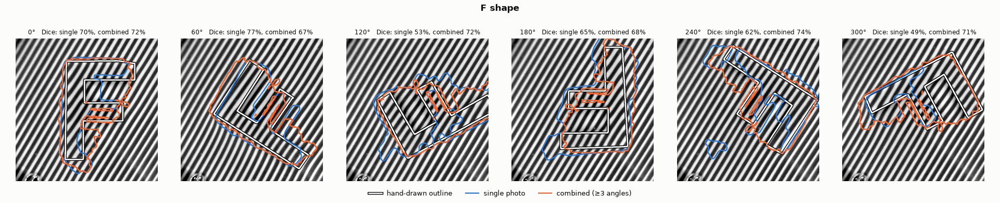
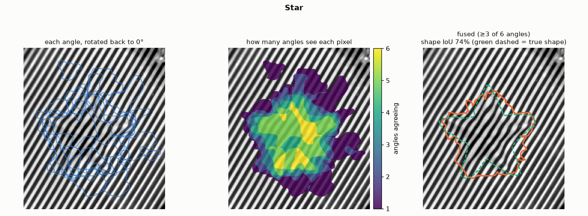
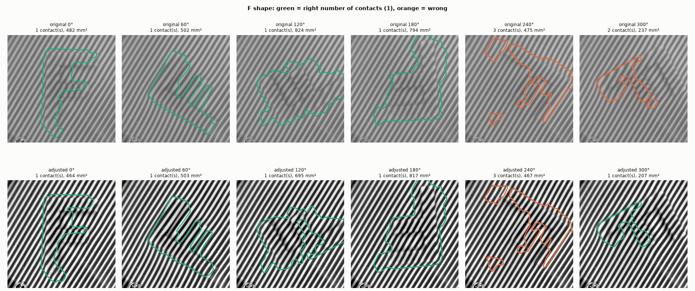

# Relatório — melhoria da segmentação de formas (pele tátil com riscas, FTP)

Luís Campos · branch `luis/baseline-validation` · atualizado a 8 de outubro de 2026

Este documento regista **tudo o que foi feito** na segmentação de formas: o ponto de partida (código do Liam), as alterações ao código, os scripts novos, os conjuntos de fotos, os resultados, o que foi testado e não entrou, as limitações e como correr cada passo. Nada do que existia foi apagado: o código e os resultados do Liam continuam no git (commit `5f63d96`) e em `src/tactile/detect_shape_liam_original.py`.

---

## 1. Objetivo

O supervisor pediu para melhorar a **segmentação das formas** pressionadas na membrana (o contorno de cada forma), com uma meta de cerca de **80%**. Ainda não está confirmado se os 80% se referem ao Dice ou ao IoU.

---

## 2. Ponto de partida (código do Liam)

- A segmentação está em `src/tactile/detect_shape.py`, na função `detect()`. Passos: demodulação FTP das riscas, diferença de fase entre a foto pressionada e a referência, filtro passa-alto, *z-score* robusto, limiar com histerese, morfologia e buracos.
- Dois modos:
  - **default (footprint)**: segmenta toda a deformação, incluindo o halo à volta do objeto. É o que o pipeline de força usa (`uniform_reconstruct.py`, `CALIB_FOOTPRINT_SCALE = 1.874`), por isso **nunca foi alterado**;
  - **tight**: corta cada contacto a 35% do seu pico de sinal (`TIGHT_LO_FRAC = 0.35`).
- Não existia nenhuma medição da qualidade da segmentação.
- Contornos de referência (GT) das fotos antigas: `data/raw/shape_pictures/<Forma>/*_gt.jpg`, desenhados à mão pelo Liam a vermelho sobre a foto pressionada (`img_02`), com um traço de ~2 mm. Existem para F, Ring, Square, Star e Three Circles.

---

## 3. O que foi feito, por fases

### Fase 1 — Medir: ferramenta de avaliação (`verification/eval_segmentation.py`)
- Lê o contorno vermelho, preenche o interior (o buraco do Ring fica vazio) e usa o meio do traço como fronteira.
- Mede **Dice, IoU, contorno a 0.5 / 1 / 2 mm, ASSD e HD95** (escala 11.8 px/mm na imagem de trabalho de 768 px, medida pelo círculo de calibração de 20 mm).
- Corre o default e o tight do Liam e o modo novo, gera uma tabela, um CSV e figuras, e tem o modo `--search` (validação *leave-one-shape-out*).
- **Diagnóstico** feito com esta ferramenta:
  - o default inclui o halo (recall ~100%, precisão baixa);
  - a máscara do tight estava **desviada ~1 mm na direção perpendicular às riscas**, porque a fase mede o deslocamento das riscas;
  - as bordas paralelas às riscas são as mais difíceis, porque o sensor só mede a fase uma vez por período (~2.3 mm).

### Fase 2 — Modo de contacto (v2) em `src/tactile/detect_shape.py`
Três passos aplicados por cima do corte tight, só quando pedidos (`detect(..., **CONTACT_PARAMS)` ou `--contact`):
1. **Sinal mais nítido**: a suavização do mapa de fase passa de 0.008 para 0.004 da imagem.
2. **Encaixe da borda** (`refine_contour`): um contorno ativo geodésico move cada borda para onde a fase varia mais depressa, só dentro de um período das riscas à volta da borda. Depois limpa manchas e buracos minúsculos e suaviza o contorno.
3. **Compensação do deslocamento** (`compensate_displacement`): puxa a máscara de volta 25% do deslocamento das riscas medido pela FTP, `u = −Δφ·n/(2π|f|)`.

Garantia: os modos default e tight dão **máscaras idênticas, píxel a píxel**, às do código original (testado em 30 casos). O pipeline de força não mudou: no par de `final_images` dá 35.6 N e 2.72 mm.

### Fase 3 — O que foi testado e ficou de fora (fotos antigas)
| tentativa | resultado | decisão |
|---|---|---|
| Refinamento Chan-Vese | IoU 71.0%, contorno 44.2% | arredonda os cantos (o F cai de 50% para 25%) |
| Canais `--use-orient` / `--use-amp` | IoU 61.7% / 48.8% | pioram |
| Fundo polinomial, fundo sem o contacto, nível de declive máximo | abaixo do tight | o passa-alto original é melhor |
| Filtrar a ondulação das riscas, alargar a banda da FTP | até +1 ponto de contorno | dentro do ruído |
| Tirar o fundo da imagem antes da FTP | +1.6 pontos de contorno | ganho pequeno, fica como opção |
| Random Forest por píxel (*leave-one-shape-out*) | Dice 82.5% vs 82.9%, contorno 61.7% vs 67.2% | não generaliza com 4 formas de treino |
| Pesquisa de parâmetros *leave-one-shape-out* | contorno ~60% em formas não vistas | só o encaixe e a compensação são estáveis |

### Fase 4 — Fotos novas com rotação (`data/raw/shape_pictures_v2/`)
- **Recolha** a 5 de outubro de 2026, entre as 14:09 e as 14:38: 8 formas (F, P, M, Ring, Square, Square Circle, Star, Three Circles) × 6 ângulos (0°, 60°, …, 300°) e uma referência (`reference.jpg`, tirada às 14:09:13).
- **Câmara diferente da do Liam**: 2520×1680 px, 22 px/mm, período das riscas de ~51 px. A janela de análise é ajustada automaticamente (`crop_ratio` ≈ 0.43) para manter 1 mm = 11.8 px.
- A câmara mexeu-se até ~16 px durante a sessão. Cada foto é **alinhada com a referência** antes da análise.
- **Ajuste de brilho/contraste** (`src/tactile/adjust_photos.py`, sugestão do supervisor): alinhamento, correção da iluminação desigual e esticamento do contraste.
  - À vista, as formas ficam muito mais claras.
  - Na segmentação **não muda nada**: 37/47 fotos com o número certo de contactos, com e sem ajuste. O método mede a posição das riscas, que não depende do brilho.
- **Diferença física nestas fotos**: a deformação de cada forma é **mais forte de um lado do que do outro** (uma "rampa"), sempre na mesma direção, e o sinal é cerca de metade do das fotos antigas. O corte a 35% perde o lado fraco; **o corte a 15%** é o que funciona melhor (37/47 contra 23/47).

### Fase 5 — Contornos novos e avaliação a sério (`data/raw/shape_pictures_v3/`)
- O Luís desenhou o contorno de **todas as 48 fotos** (linha vermelha fina sobre a foto).
- `verification/build_dataset_v3.py` monta o conjunto v3:
  - para cada desenho, encontra a foto sobre a qual foi feito;
  - **Three Circles**: os ângulos seguem os nomes dos desenhos (a foto que estava como 0° é a de 60°, e assim por diante). A foto nova de 0° só existia com o desenho; a versão limpa foi reconstruída preenchendo a linha de 1–2 px a partir dos vizinhos (*inpainting*);
  - a foto repetida dos Three Circles deixou de existir.
- `verification/eval_photos_v3.py` avalia as 48 fotos com os contornos. A linha é detetada como diferença face à foto limpa, as aberturas são fechadas ligando pontas próximas (como no F a 0°) e o preenchimento respeita buracos (Ring e a barriga do P).

### Fase 6 — Combinar os 6 ângulos (`verification/fuse_angles.py`, `eval_photos_v3.py`)
- Cada máscara é rodada de volta a 0° à volta do eixo de rotação, estimado pela média dos centros das 6 máscaras e afinado pela concordância entre elas. Um píxel fica na forma combinada se **pelo menos 3 dos 6 ângulos** o virem.
- A primeira estimativa, com os contornos do Liam como molde, dava +12 pontos. Com os contornos reais, o ganho é **+2.4 pontos de Dice**. **Este é o número válido.**

---

## 4. Resultados finais

Tabela completa em `results/segmentation_v2/method_comparison.png` (também `.csv` e `.md`). Valores em %, média sobre as fotos.

| método | antigas: Dice | antigas: IoU | antigas: contorno ≤1 mm | novas: Dice | novas: IoU | novas: contorno ≤1 mm |
|---|---|---|---|---|---|---|
| Liam: default (footprint) | 72.5 | 58.0 | 21.2 | 61.9 | 46.6 | 23.0 |
| Liam: tight | 80.9 | 68.0 | 51.4 | 54.4 | 39.5 | 36.8 |
| Modo de contacto (corte 35%) | **82.9** | **71.0** | **67.2** | 54.4 | 39.7 | **44.4** |
| Modo de contacto, corte 15% | 79.9 | 67.4 | 55.8 | 66.7 | 51.6 | 38.2 |
| Corte 15% + 6 ângulos combinados | — | — | — | **69.0** | **54.1** | 33.8 |

- **Fotos antigas**: 5 fotos, contornos do Liam. O modo de contacto foi afinado nestas mesmas fotos, por isso os valores são otimistas. Em formas não vistas, o contorno fica em ~60%.
- **Fotos novas**: 48 fotos, contornos do Luís. Não foram usadas para afinar; só o corte a 15% foi escolhido nelas, sem os contornos.
- **Significância nas fotos novas** (teste de Wilcoxon emparelhado, contra o tight do Liam, 48 fotos):
  - **corte 15%**: Dice +12.3 pontos, melhor em 40/48 fotos, p = 2×10⁻⁷;
  - **6 ângulos combinados**: Dice +14.7 pontos, melhor em 32/48, p = 4×10⁻⁵;
  - **corte 35%**: contorno a 1 mm +7.6 pontos, p = 6×10⁻¹⁰;
  - **combinado contra uma foto sozinha** (corte 15%): Dice +2.4 pontos, melhor em 27/48, p = 0.13, **não significativo**.
- **Dice por forma nas fotos novas** (tight → corte 15% → combinado):

| forma | tight | corte 15% | combinado |
|---|---|---|---|
| F | 47.9 | 62.5 | 70.7 |
| M | 63.3 | 75.1 | 75.8 |
| P | 43.6 | 65.8 | 75.2 |
| Ring | 56.5 | 72.3 | 76.9 |
| Square | 41.9 | 67.5 | 74.9 |
| Square Circle | 81.9 | 86.5 | 80.9 |
| Star | 52.3 | 45.1 | 46.3 |
| Three Circles | 47.7 | 58.6 | 51.6 |

- **Precisão do contorno por orientação da borda** (fotos antigas, modo de contacto, tight entre parêntesis): perpendicular às riscas 77.7% (63.2%), oblíqua 66.9% (53.7%), paralela 64.9% (38.9%).

### Figuras principais

**Todos os métodos nos dois conjuntos de fotos**


**Fotos antigas: Dice, IoU e contorno por forma** (verde: default do Liam; azul: tight do Liam; laranja: modo de contacto)


**Fotos antigas, exemplo do Square**: contorno de referência a branco; default do Liam, tight do Liam e modo de contacto


**Fotos novas: ajuste de brilho/contraste** (em cima a original, em baixo a ajustada)


**Fotos novas com o contorno desenhado, exemplo do F**: contorno a branco, uma foto sozinha a azul (corte 15%), 6 ângulos combinados a laranja


**Como funciona a combinação dos ângulos, exemplo da Star**: os 6 contornos rodados para 0°, quantos ângulos veem cada píxel, forma combinada


**Segmentação com e sem ajuste de brilho/contraste, exemplo do F** (verde = número certo de contactos)


---

## 5. Limitações

- **Os contornos de referência são desenhados à mão.** O do Liam tem ~2 mm de traço: deslocá-lo 1 mm já dá um IoU de ~76%, o que impõe um teto à medição.
- **Bordas paralelas às riscas**: a resolução nessa direção está limitada pelo período das riscas (~2.3 mm).
- **O melhor corte depende da câmara**: 35% nas fotos antigas e 15% nas novas. Ainda não é escolhido automaticamente.
- **Fotos novas**: sinal mais fraco e desigual (uma rampa ao longo da forma), uma única referência para 30 minutos e a câmara a mexer-se até ~16 px. Todos os métodos descem nestas fotos, incluindo o do Liam.
- **Combinar ângulos** ajuda nas formas de uma só peça (F, P, Square, Ring), mas piora nas que têm peças separadas (Square Circle, Three Circles), porque um pequeno erro no centro de rotação desloca cada peça.
- **Star**: má em todos os métodos (≤55%). As deteções são ~3× maiores do que o contorno desenhado.
- **Partes pressionadas com menos força** (por exemplo a barriga do P nas fotos antigas) são cortadas pelo limiar relativo ao pico.

---

## 6. Alterações ao código

### 6.1 `src/tactile/detect_shape.py` (alterado pelo Luís)

Diferença face ao original do Liam: cerca de 140 linhas, quase todas acrescentadas. Algumas existentes foram alteradas: `STEM`, o valor por omissão do `demodulate`, a assinatura do `detect()` e as linhas onde entram os parâmetros novos. O comportamento antigo mantém-se por omissão.

**Imports e configuração**
```python
from skimage.segmentation import (inverse_gaussian_gradient,
                                  morphological_geodesic_active_contour)

STEM = None           # antes "star"; agora o nome sai da pasta e do ficheiro da foto deformada
BW_FRAC = 0.55        # largura da banda da FTP (o valor que já estava no demodulate)

# --- modo de contacto ---
GAC_SIGMA_FRAC = 0.0026      # suavização do mapa de bordas (~2 px @768)
GAC_ITERS = 20               # iterações do contorno ativo geodésico
DISP_BG_MARGIN_FRAC = 0.052  # fundo da fase medido a esta distância da máscara
DISP_SMOOTH_FRAC = 0.0052    # suavização do campo de deslocamento (~4 px @768)
CONTACT_PARAMS = dict(tight=True, smooth_frac=0.004, refine=True,
                      disp_alpha=0.25)
```

**Funções novas**
```python
def refine_contour(mask, score, roi, carrier, iters=GAC_ITERS):
    """Snap the mask boundary onto the steepest part of the score."""
    if not mask.any():
        return mask
    n = mask.shape[0]
    s = score.astype(np.float64) / max(float(np.percentile(score[roi], 99.5)), 1e-9)
    edges = inverse_gaussian_gradient(s, sigma=max(GAC_SIGMA_FRAC * n, 1.0))
    snapped = morphological_geodesic_active_contour(
        edges, num_iter=iters, init_level_set=mask, smoothing=1,
        threshold="auto", balloon=0)
    period = int(round(n / np.hypot(*carrier)))          # um período das riscas
    k = cv2.getStructuringElement(cv2.MORPH_ELLIPSE, (2 * period + 1,) * 2)
    band = (cv2.dilate(mask, k) > 0) & (cv2.erode(mask, k) == 0)
    out = mask.copy()
    out[band] = snapped[band]                             # só mexe perto da borda
    floor = MIN_COMP_ABS * out.size                       # tira manchas e buracos minúsculos
    for val in (1, 0):
        n_c, c_lab, c_stats, _ = cv2.connectedComponentsWithStats(
            (out == val).astype(np.uint8))
        for j in range(1, n_c):
            if c_stats[j, cv2.CC_STAT_AREA] < floor:
                out[c_lab == j] = 1 - val
    sm = cv2.GaussianBlur(out.astype(np.float32), (0, 0),  # suaviza os degraus das riscas
                          max(FINAL_SMOOTH_FRAC * n, 1.5))
    return (sm > 0.5).astype(np.uint8)


def compensate_displacement(mask, dphi, carrier, roi, alpha):
    """Move a mask from the deformed image back onto the undeformed membrane."""
    if alpha == 0 or not mask.any():
        return mask
    n = mask.shape[0]
    fy, fx = float(carrier[0]), float(carrier[1])
    fr = np.hypot(fy, fx)
    r = int(round(DISP_BG_MARGIN_FRAC * n))
    k = cv2.getStructuringElement(cv2.MORPH_ELLIPSE, (2 * r + 1,) * 2)
    bg = roi & (cv2.dilate(mask, k) == 0)                 # fundo longe do contacto
    if not bg.any():
        bg = roi
    ph = cv2.GaussianBlur((dphi - np.median(dphi[bg])).astype(np.float32),
                          (0, 0), max(DISP_SMOOTH_FRAC * n, 1.0))
    u = -ph * (n / (2 * np.pi * fr))                      # deslocamento das riscas (px)
    yy, xx = np.mgrid[:n, :n].astype(np.float32)
    map_x = (xx + alpha * (fx / fr) * u).astype(np.float32)
    map_y = (yy + alpha * (fy / fr) * u).astype(np.float32)
    warped = cv2.remap(mask.astype(np.float32), map_x, map_y, cv2.INTER_LINEAR)
    return ((warped > 0.5) & roi).astype(np.uint8)
```

**Alterações dentro de `detect()`** (excerto resumido; o código completo está no ficheiro)
```python
def detect(ref_path, def_path, size=PROC_SIZE, crop_ratio=CROP_RATIO,
           use_orient=False, use_amp=False, tight=False, bw_frac=None,
           smooth_frac=None, tight_lo_frac=None, refine=False,
           disp_alpha=0.0):
    if bw_frac is None:        bw_frac = BW_FRAC              # valores antigos por omissão
    if smooth_frac is None:    smooth_frac = SMOOTH_SIGMA_FRAC
    if tight_lo_frac is None:  tight_lo_frac = TIGHT_LO_FRAC
    ...
    z_ref, carrier = demodulate(g_ref, bw_frac=bw_frac)
    z_def, _ = demodulate(g_def, carrier=carrier, bw_frac=bw_frac)
    ...
    hp = cv2.GaussianBlur(hp, (0, 0), max(smooth_frac * n, 1.5))
    ...
            keep_c = comp & (score > tight_lo_frac * local_peak)   # o "corte"
    ...
    mask = (sm > 0.5).astype(np.uint8)
    # contact mode: snap the edges, then undo the stripe displacement
    if refine:
        mask = refine_contour(mask, score, roi, carrier)
    mask = compensate_displacement(mask, dphi, carrier, roi, disp_alpha)
```

**Linha de comandos**: flags novas `--reference`, `--deformed`, `--stem` e `--contact`.

### 6.2 Ficheiros novos

| ficheiro | o que faz | lê | escreve |
|---|---|---|---|
| `src/tactile/detect_shape_liam_original.py` | cópia exata do código original do Liam (v1) | — | — |
| `src/tactile/adjust_photos.py` | alinha cada foto com a referência e ajusta brilho/contraste | `data/raw/<conjunto>/` | `data/processed/<conjunto>/` |
| `verification/eval_segmentation.py` | avaliação nas fotos antigas (Dice, IoU, contorno, figuras, `--search`) | `data/raw/shape_pictures/` | CSV + figuras |
| `verification/segment_photos_v2.py` | segmenta as fotos rodadas sem contorno (contactos e área por ângulo) | fotos ajustadas | CSV + figuras |
| `verification/compare_adjustment.py` | segmentação com e sem ajuste de brilho/contraste, lado a lado | fotos v2 | `…/shape_pictures_v2/brightness_contrast/` |
| `verification/fuse_angles.py` | combina os 6 ângulos e compara com o molde do Liam | fotos v2 ajustadas | `…/shape_pictures_v2/fusion/` |
| `verification/build_dataset_v3.py` | monta o conjunto v3 a partir dos desenhos | fotos v2 + desenhos | `data/raw/shape_pictures_v3/`, `data/annotations/shape_pictures_v3/` |
| `verification/eval_photos_v3.py` | avaliação das 48 fotos com os contornos, incluindo a combinação | v3 | `…/shape_pictures_v3/` (CSV + figuras) |
| `verification/compare_methods_table.py` | tabela única com todos os métodos nos dois conjuntos | v3 CSV + fotos antigas | `results/segmentation_v2/method_comparison.*` |
| `verification/show_adjusted.py` | imagens antes/depois do ajuste de brilho/contraste | v3 | `…/shape_pictures_v3/before_after/` |
| `docs/relatorio_segmentacao.md` | este relatório | — | — |

---

## 7. Dados e resultados

| pasta | conteúdo |
|---|---|
| `data/raw/shape_pictures/` | fotos antigas do Liam (inalteradas) |
| `data/raw/shape_pictures_v2/` | 48 fotos rodadas + referência, tal como recolhidas |
| `data/raw/shape_pictures_v3/` | as mesmas fotos com os ângulos dos Three Circles corrigidos e a foto de 0° reconstruída |
| `data/annotations/shape_pictures_v3/` | os 48 contornos desenhados (`rot_XXX_gt.jpg`) |
| `data/processed/shape_pictures_v2/` e `_v3/` | fotos alinhadas e ajustadas (geradas; 106 MB cada, não guardar no git) |
| `results/images_report/` | figuras originais do Liam (inalteradas) |
| `results/segmentation_v2/shape_pictures/` | resultados nas fotos antigas (tabela + figuras) |
| `results/segmentation_v2/shape_pictures_v2/` | fotos rodadas sem contorno: segmentação, brilho/contraste, fusão com molde |
| `results/segmentation_v2/shape_pictures_v3/` | fotos rodadas com contorno: `eval_photos_v3.csv`, figuras, antes/depois |
| `results/segmentation_v2/method_comparison.*` | tabela de todos os métodos |

### Todas as figuras

| pasta | o que cada figura mostra | ficheiros |
|---|---|---|
| `results/segmentation_v2/` | tabela de todos os métodos nos dois conjuntos | `method_comparison.png` |
| `results/segmentation_v2/shape_pictures/figures/` | fotos antigas: um painel por modo (default, tight, contacto) com o contorno de referência e os valores; resumo em barras | `F_shape_img_02`, `Ring_img_02`, `Square_img_02`, `Star_img_02`, `Three_Circles_img_02`, `summary` |
| `results/segmentation_v2/shape_pictures_v2/figures/` | fotos novas sem contorno: segmentação dos 6 ângulos de cada forma, com contactos e área | uma por forma (8) |
| `results/segmentation_v2/shape_pictures_v2/brightness_contrast/` | segmentação na foto original (em cima) e na ajustada (em baixo) | uma por forma (8) |
| `results/segmentation_v2/shape_pictures_v2/fusion/` | combinação dos ângulos comparada com o molde do Liam (estimativa antiga, substituída pela avaliação com os teus contornos) | uma por forma (8) |
| `results/segmentation_v2/shape_pictures_v3/figures/` | fotos novas com o teu contorno: foto sozinha e 6 ângulos combinados, com o Dice de cada uma | uma por forma (8) |
| `results/segmentation_v2/shape_pictures_v3/before_after/` | fotos originais e ajustadas lado a lado | `overview` + uma por forma (8) |
| `figures/segmentation/` | versão de 29 de setembro das figuras das fotos antigas (antes das últimas mudanças de formato) | 6 |
| `figures/shape_pictures_v2/` | primeira saída da segmentação das fotos novas (igual a `results/.../shape_pictures_v2/figures/`) | 8 |
| `figures/` | figuras dos teus audits anteriores de força e temperatura | `force_linearity`, `force_noise`, `force_period_vs_load`, `force_sensitivity`, `temp_*_curves`, `temp_*_sensitivity` |
| `results/images_report/` | figuras originais do Liam (inalteradas) | 53 + `3d_recon` + `figures_final` |

---

## 8. Como correr tudo do zero

```bash
cd ~/master_thesis
source .venv/bin/activate

# fotos antigas: avaliação (tabela, CSV, figuras)
python verification/eval_segmentation.py
python verification/eval_segmentation.py --search          # opcional, 5–10 min

# uma foto sozinha, modo antigo e modo novo
python src/tactile/detect_shape.py --tight   --reference "data/raw/shape_pictures/Star/img_01.jpg" --deformed "data/raw/shape_pictures/Star/img_02.jpg" --stem Star_tight
python src/tactile/detect_shape.py --contact --reference "data/raw/shape_pictures/Star/img_01.jpg" --deformed "data/raw/shape_pictures/Star/img_02.jpg" --stem Star_contact

# fotos rodadas com contornos (v3)
python verification/build_dataset_v3.py                     # só se os desenhos mudarem (lê ~/Desktop)
python src/tactile/adjust_photos.py data/raw/shape_pictures_v3 data/processed/shape_pictures_v3
python verification/show_adjusted.py                        # antes/depois do brilho/contraste
python verification/eval_photos_v3.py                       # Dice/IoU por foto + combinação
python verification/compare_methods_table.py                # tabela de todos os métodos

# ver os resultados
open results/segmentation_v2/method_comparison.png
open results/segmentation_v2/shape_pictures_v3/figures
open results/segmentation_v2/shape_pictures_v3/before_after
```

**Acrescentar uma foto nova da mesma sessão**: copiar para `data/raw/shape_pictures_v3/<Forma>/rot_XXX.jpg` e o contorno para `data/annotations/shape_pictures_v3/<Forma>/rot_XXX_gt.jpg`. Guardar uma cópia de `results/segmentation_v2/shape_pictures_v3/` e voltar a correr os quatro comandos do bloco v3. Uma sessão nova (outra referência) precisa de uma pasta nova (`shape_pictures_v4`).

---

## 9. Pendentes e próximos passos

1. **Correção no `refine_contour`**: suavizar **antes** de limpar as manchas, para a forma P das fotos antigas deixar de contar 2 contactos. Os números não mudam.
2. **Guardar no git**: o trabalho ainda não está em commit. Repor o `.gitignore` primeiro, para não irem o `.venv/` nem as pastas `data/processed/*` (geradas).
3. **Confirmar com o supervisor** se os 80% são em Dice ou em IoU.
4. **Escolher o corte automaticamente** consoante a câmara (35% na antiga, 15% na nova).
5. **Melhorar a combinação nas formas com várias peças**, alinhando cada peça separadamente.
6. Nas próximas recolhas: **uma referência antes de cada toque**, toques a direito com força constante e uma pausa entre toques.

## 10. Notas

- **Trabalho anterior a este relatório** (já existia, não foi alterado): os audits de qualidade das fotos e dos dados de força e temperatura, em `verification/audit_shape.py`, `audit_images_V3.py`, `audit_temperature.py` e `plot_force.py`, com as tabelas `verification/audit_*.csv` e as figuras `figures/force_*.png` e `figures/temp_*.png`. Este relatório não analisa as conclusões desses audits.
- Os audits antigos (`audit_shape.py`, `audit_images_V3.py`) e `estimate_force_depth.stripe_period_fft` medem a **3.ª harmónica** das riscas (período ~25 px em vez de ~75 px nas fotos do Liam). O rácio usado na força não é afetado, mas as conclusões dos audits sobre o período devem ser revistas.
- A página de resumo da reunião de 29 de setembro (https://claude.ai/artifact/7VSEomPUFWABPYA3RjKq4r) só cobre as fotos antigas.
